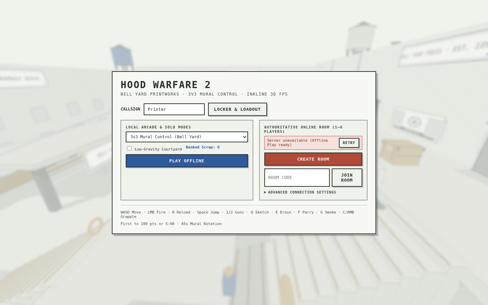
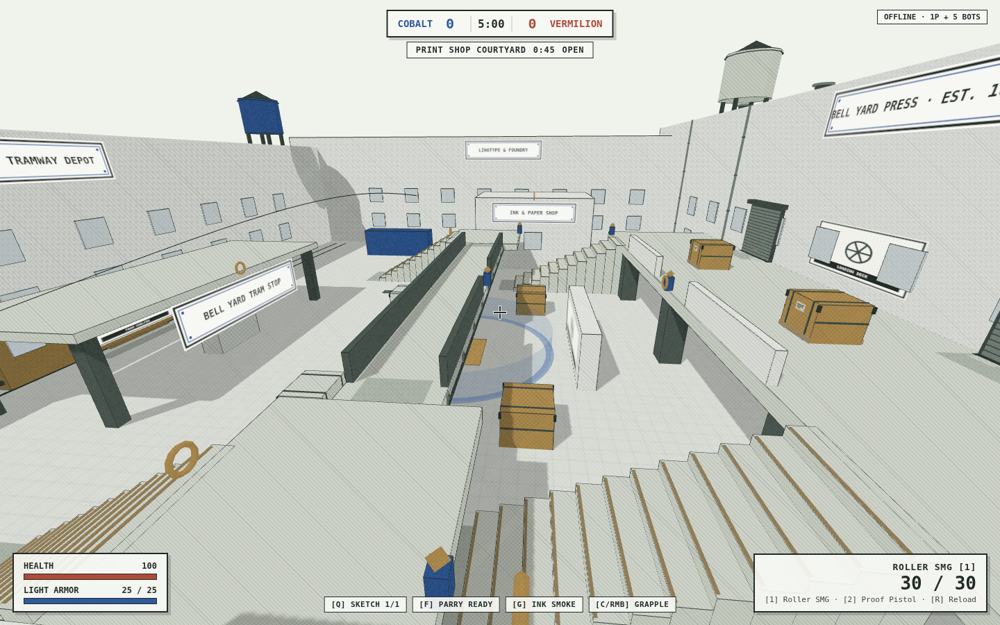

# Hood Warfare 2

A 3D first-person arcade shooter set in **Bell Yard**, an Inkline Town–inspired printworks district, built with TypeScript, [`@typeonce/ritmo`](https://github.com/typeonce-dev/ritmo), Three.js, Vite, and WebSockets (`ws`).

### [▶ Play now](https://unrealumanga.github.io/hood-warfare-2/)




Play Offline works on GitHub Pages. Play Online needs the Node WebSocket server (`npm run dev`), so it only works locally.

---

## Features

- **Play Offline**: Instant 3v3 Bell Yard Mural Control (1 human + 5 bots) plus **Elite Duel (Shielded Printworks Foreman)**, **Solo Extraction (Press Vault)**, **Foundry Skirmish (Colossus Rotary Press)**, and optional **Low-Gravity Courtyard Anomaly**. Runs 100% locally with zero network dependencies.
- **Play Online**: Create or join a room by 4-letter code (1–6 human players, bots fill open slots). Mid-match joiners take over a bot on its next spawn; departing humans yield their slot to a bot; closing the room creator's browser leaves all remaining clients playing on the authoritative Node server. Raw WebSocket URL sits under **Advanced connection settings** alongside a live retryable server status badge.
- **Bell Yard Inkline 3D Environment**: High-key paper ground (`#f0f2ec`), gray-green ink (`#3d4943`), 3-band cel shading with screen-space pen hatching & halftone shadows, instanced eye-level printworks detail (`src/client/yardDetails.ts`: strapped freight crates, corrugated press-hall goods doors with threshold dust, Line 04 tram bogies seated on steel rails + timetable plate, riveted footbridge splices, brass stair nosings, flush street drains), and an overhead moving **Cable Car**.
- **Tactical Combat & Ink Kit**:
  - **Press Sniper + Optical Scope (`RMB`)**: Scoped bolt-action sniper (`95` body / 1-shot head, `24°` Inkline SVG scope overlay, `0.35×` scoped sensitivity, pinpoint scoped accuracy vs hipfire penalty). Holding `RMB` also provides `55°` ADS zoom and tightened spread/recoil on all other firearms.
  - **Frag Grenade (`G`)**: Real 3D ballistic throw with wall/floor bounce physics, 1.5s fuse, radial blast (`115` max dmg), smoke clearing, and barrel chain-detonation.
  - **Remote C4 Ink Satchel (`B`)**: First press plants a sticky C4 satchel with pulsing LED on any wall/floor/crate/barrel; second press remote-detonates from anywhere (`140` max dmg, destroys rival constructs, chain-detonates barrels).
  - **Commando Knife (`F` quick jab / `[3]` blade slot)**: Close-quarters slash (`55` front / `110` backstab) unified with the active `0.30s` **Ink Parry** projectile-reflection window.
  - **Explosive Press Barrels**: `25 HP` courtyard barrels emit metallic sparks/hitmarkers on damage and trigger full Inkline blast shockwaves with chain-detonation.
  - **Solid Body Collisions**: Enemies cannot pass through fighters like ghosts; allies use soft separation so teammates never lock doorways.
  - **State-of-the-Art NPC Bot AI (`src/sim/botAi.ts`)**: Anti-stuck displacement watchdog + lateral jump escape, dual wall-feeler steering, weighted Dijkstra routing with recency penalties & role diversity (`breacher`, `flanker`, `anchor`), vision cones, target memory, hazard dodging, and close-range knife/grenade tactics across all difficulty tiers.
  - **Sketch & Erase (`Q` / `LMB` / `E`)**, **Target-Sensitive Grapple (`C`)**, and **Ink Smoke (`T`)**.
- **5 Core Guns + Cursed Loadout + Commando Knife + 2 Armors + Locker**:
  - **Proof Pistol** (Sidearm `[2]`): 20 dmg, 12 mag, semi-auto.
  - **Roller SMG** (Primary `[1]`): 14 dmg, ~9 shots/sec, 30 mag, learnable recoil pattern.
  - **Broadside** (Primary `[1]`): 5-pellet wide fan, 12 dmg/pellet, 1 shot/sec, 5 volleys mag.
  - **Linecaster** (Primary `[1]`): bright straight marksman bolt, 48 dmg, 1.4 shots/sec, 6 mag.
  - **Press Sniper** (Primary `[1]`): bolt-action scoped sniper (`RMB` 24° optic), 95 body / 238 headshot, 5 mag.
  - **Cursed Proof-Block** (Voluntary single-shot primary): 88 dmg, 1-round breech, `1.5×` match score applied once, unlocks the **Gilded Folio** swatch and returns to your normal primary next run.
  - **Commando Knife** (Melee `[3]` / quick jab `[F]`): 55 front / 110 backstab + projectile parry.
  - **Light Vest** (+25 armor, 100% speed) & **Heavy Press Plate** (+50 armor, 90% speed, thick vest silhouette).

---

## Commands

### 1. Install Dependencies (using lockfile)

```bash
npm ci
```

### 2. Single-Command Local Development (Recommended)

Starts both the authoritative WebSocket server (`ws://localhost:8787`) and Vite dev client (`http://localhost:5173`) together, checks for occupied ports with actionable errors, and stops both cleanly on `Ctrl+C`:

```bash
npm run dev
```

`npm run dev:all` remains an alias for the same launcher. Use `PORT` and `VITE_PORT` to override the server and client ports.

Or run them separately for debugging:

```bash
npm run dev:server   # Node authoritative WebSocket server (port 8787)
npm run dev:client   # Vite browser client (port 5173)
```

### 3. Production Build & Server

```bash
npm run build
npm run start:server
```

Serves both the built client (`dist/`) and authoritative WebSocket server on `http://localhost:8787`.

### 4. Hosted WSS Configuration

Configure a remote WebSocket server via any of:
1. Build-time env var: `VITE_WS_URL=wss://your-server.example.com npm run build:client`
2. URL query param: `https://your-client.example.com/?ws=wss://your-server.example.com`
3. Title screen → **Advanced connection settings** input field.

### 5. Verification Suite

```bash
npm run check
```

Runs `tsc --noEmit`, `oxlint` (including `@typeonce/oxlint-plugin-ritmo`), `ritmo-devtools lint src/lint.ts`, and `vitest run` (`tests/sim.test.ts`, `tests/milestones.test.ts`, `tests/online.test.ts`).

---

## Controls

| Input | Action |
|---|---|
| `W A S D` | Move |
| `Mouse` | Aim (first click captures pointer lock without firing or spending sketch charges) |
| `Left Click` | Fire / Knife Slash (or commit active Sketch preview) |
| `Right Click (Hold)` | ADS Zoom (`55°`) / Press Sniper Optical Scope (`24°`) |
| `R` | Reload |
| `Space` | Jump (or release active Grapple mid-air) |
| `V` / `Left Ctrl` | Hold Crouch |
| `1` / `2` / `3` | Switch Primary / Proof Pistol / Commando Knife |
| `F` | Quick Commando Knife Jab + Timed Ink Parry (reflects incoming bolts) |
| `G` | Throw Frag Grenade (3D bounce + 1.5s fuse blast) |
| `B` | Plant Remote C4 Ink Satchel / 2nd Press Remote Detonate |
| `Q` | Cycle Sketch preview (`Anchor / Free Plank` → `Barricade` → `Cancel`) |
| `E` | Erase rival construct within melee reach |
| `C` | Target-sensitive Grapple (ledge pull-self or barrel/target pull) |
| `T` | Deploy Ink Smoke screen |
| `Escape` | Cancel Sketch preview or release pointer lock & open menu |

---

## Reproducing Key Acceptance Encounters

- **Bell Yard Visual Inspection (`1280×720`)**: Start `npm run start:server` and open `http://localhost:8787/?inspect=courtyard`, `?inspect=deck`, or `?inspect=tram` to inspect matched eye-level views with HUD and a contested courtyard zone.
- **Milestone 1 Sketch Plank Crossing & Erase**: Climb onto the central Footbridge, look north at the blue/brass anchor post facing the Upper Loading Deck, press `Q` then `LMB` to draw the plank, cross it, and have a rival press `E` within melee reach to erase it.
- **Two-Browser Online Resilience**: Open two tabs at `http://localhost:8787`, click **Create Room** in Tab 1, join the 4-letter code in Tab 2, start the match, then close Tab 1 — Tab 2 continues playing seamlessly while bots fill the departed slot.
